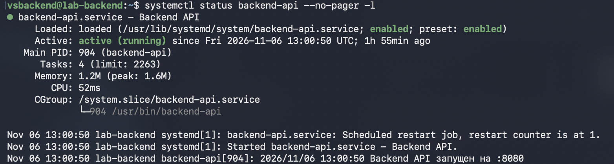
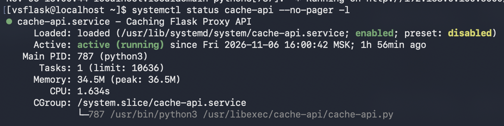
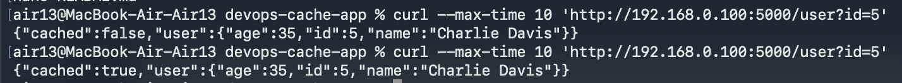
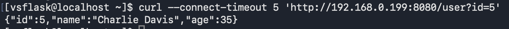
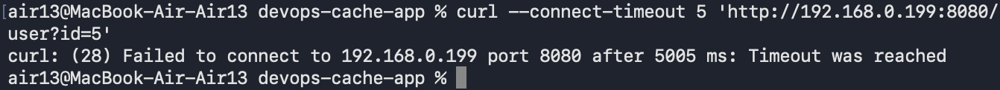

# Тестовое приложение с кэширующим слоем

Развёрнуты PostgreSQL, Go Backend, Redis и Flask Proxy на четырёх виртуальных машинах. Backend установлен из DEB-пакета, Proxy — из RPM-пакета.

## Работающие службы

Backend запущен через systemd, автозапуск включён.

Proxy запущен через systemd, автозапуск включён.

## Проверка кэширования

Первый запрос возвращает `cached: false`, повторный — `cached: true`.

## Проверка сетевых ограничений

Запрос с Proxy к Backend проходит успешно.

Прямой запрос с Mac к Backend блокируется.

## Файлы проекта

- [Правила фаерволов — rules.sh](rules.sh)
- [Описание DEB-пакета — control](backend/control)
- [Спецификация RPM-пакета](proxy/cache-api.spec)
- [Systemd unit Backend](backend/backend-api.service)
- [Systemd unit Proxy](proxy/cache-api.service)
